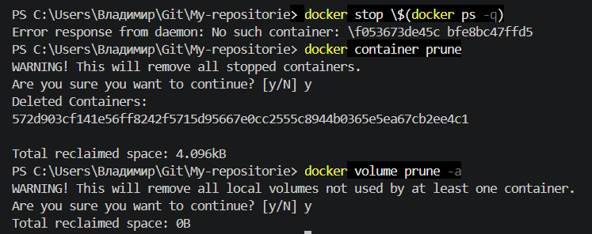
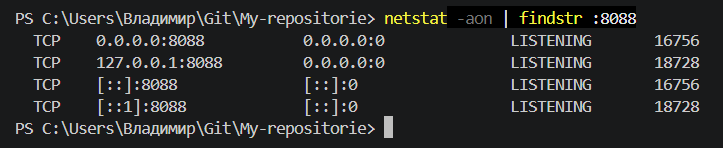
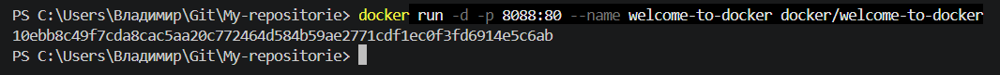
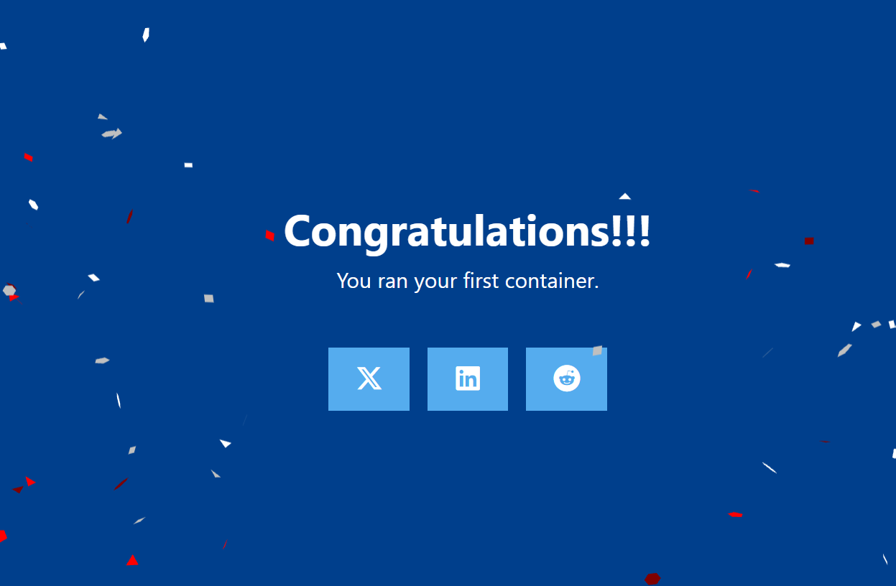
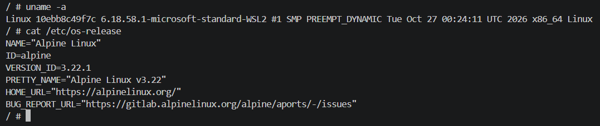
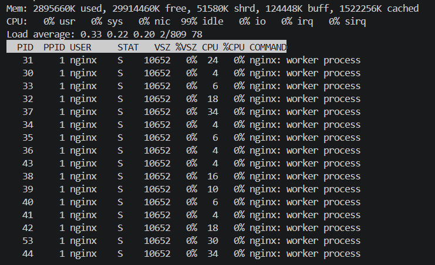
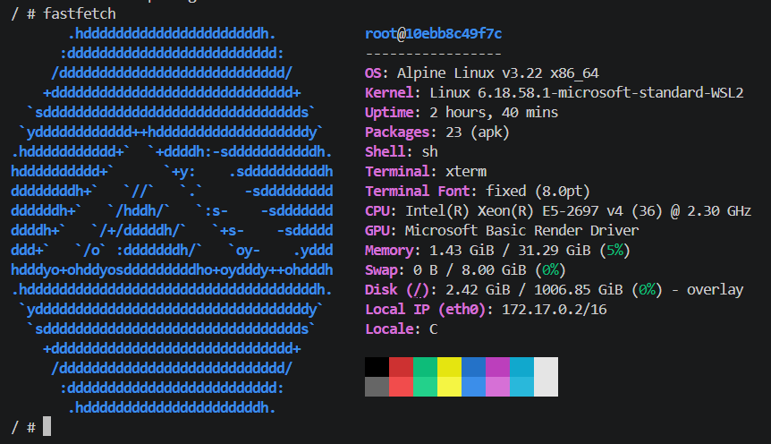

# Welcome to Docker

## 1. Подготовка и очистка среды
Перед началом работы были остановлены и удалены старые учебные контейнеры, тома и неиспользуемые образы, чтобы начать проект с «чистого листа».

Выполненные команды:
```bash
docker stop \$(docker ps -q)
docker container prune
docker volume prune -a
```



---

## 2. Проверка доступности порта 8088
Проверил, что порт `8088` не занят другими приложениями.

Выполненная команда:
```bash
# Для Linux:
netstat -tuln | grep :8088

# Для Windows:
netstat -aon | findstr :8088
```



---

## 3. Загрузка образа и запуск контейнера
Скачал образ `docker/welcome-to-docker` и запустил контейнер в фоновом режиме с пробросом порта `8088` на внутренний порт `80`.

Выполненная команда:
```bash
docker run -d -p 8088:80 --name welcome-to-docker docker/welcome-to-docker
```



---

## 4. Проверка работы в браузере
Открыл в браузере адрес `http://localhost:8088` и убедился, что стартовая страница приветствия Docker успешно загружается.



---

## 5. Работа внутри контейнера и изучение ОС
Подключился к интерактивной оболочке запущенного контейнера и проверил информацию об операционной системе и структуре каталогов.

Выполненные команды:
```bash
docker exec -it welcome-to-docker /bin/sh
uname -a
cat /etc/os-release
tree
```



Проверил запущенные процессы с помощью диспетчера ресурсов:
```bash
top
```



---

## 6. Обновление пакетов и установка fastfetch
Обновил индекс пакетов менеджера `apk`, установил утилиту `fastfetch`, запустил её для отображения сводки о системе и вышел из контейнера.

Выполненные команды:
```bash
apk update && apk upgrade
apk add fastfetch
fastfetch
exit
```


